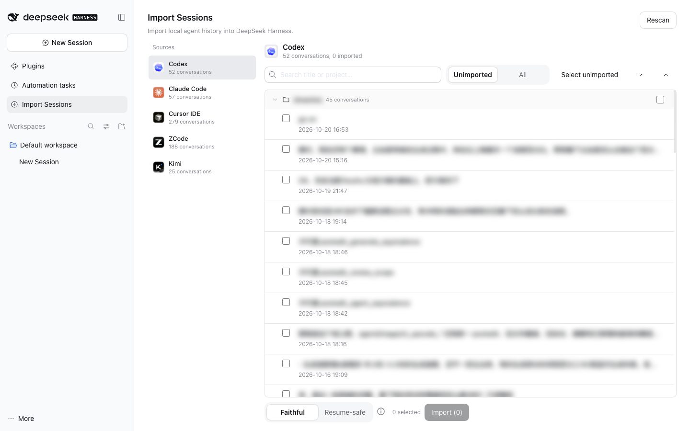

# dsh-agent-session-sync

> 本项目是 [dsh-agent-session-import](https://github.com/howtomakeaname/dsh-agent-session-import)（MIT）的深度改进分支：
> 在原版「第三方 agent → DSH」单向导入的基础上，新增了 DSH → 第三方 agent 的导出方向、
> 重复导入自动合并、工作区归组与面板 UI 重构，并更名为 **dsh-agent-session-sync**。

在 **DeepSeek Harness（DSH）** 与本机第三方 coding agent 之间**双向导入对话记录**。

两个方向都是主体功能，互相对称：

| 方向 | 做什么 | 支持的对象 |
| --- | --- | --- |
| **导入到 DSH** | 把第三方 agent 的本地历史变成 DSH 会话 | Codex、Claude Code、Cursor、ZCode、Kimi、WorkBuddy |
| **导入到第三方 agent** | 把 DSH 会话写回本机第三方 agent | WorkBuddy |

一个可安装的 DSH bundle 插件：host 侧只读写本机文件、不联网，浏览器侧提供操作面板；零运行时依赖、无需构建。

导入到 DSH 支持的来源：

| 来源 | 读取的本地数据（只读） |
| --- | --- |
| **Codex**（CLI / 桌面版共用同一存储） | `~/.codex/sessions/**.jsonl` + `~/.codex/thread_history_1.sqlite` |
| **Claude Code** | `~/.claude/projects/**.jsonl` |
| **Cursor IDE**（Agent / Composer） | `~/Library/Application Support/Cursor/User/globalStorage/state.vscdb` |
| **ZCode** | `~/.zcode/cli/db/db.sqlite` |
| **Kimi**（Kimi Code CLI / 桌面端） | `~/.kimi-code/sessions`（Windows：`%USERPROFILE%\.kimi-code\sessions`，可用 `KIMI_CODE_HOME` 覆盖；macOS 另含桌面端 runtime 路径） |
| **WorkBuddy** | `~/workbuddy/projects/**.jsonl` + `<sessionId>.meta.json`（可用 `WORKBUDDY_HOME` 覆盖；会话内嵌 `cwd`，无需依赖父目录编码） |

WorkBuddy 的 JSONL 事件格式细节见 [docs/workbuddy-format.md](docs/workbuddy-format.md)。

导入到 DSH 的会话会**归入它原来的工作区**：按来源的项目目录找到已有工作区，没有就新建一个
（标题取目录名，如 `DeepHarness`）并把会话挂进去；原对话没有项目目录时留在「未分组」。
详见 [docs/usage.md](docs/usage.md) 1.4。

## 导入到第三方 agent（DSH → 其他 agent）

面板顶部切到「导入到其他 agent」标签页：把**本机 DSH 会话**写回第三方 agent。

| 目标 agent | 写入位置 | 状态 |
| --- | --- | --- |
| **WorkBuddy** | `~/.workbuddy/projects/<项目>/<uuid>.jsonl` + `workbuddy.db` 的 `sessions` 表 | 可用 |

写入**一步完成**：选好会话与目标后，面板自动核对这次要写什么（目标文件、行数与消息数、
这是新建还是更新、备份位置），摆在同一屏上；点「导出到 WorkBuddy」即落盘。没有单独的
「预览」按钮——但写入按钮只在**当前这组设置**的计划已经显示时才可用，换了会话/目标/内容形式
就会变灰重算，所以「确认过才写」这条底线不变。

写入是 **upsert**：同一条 DSH 会话再次导入会**原地更新** WorkBuddy 里那一条（先备份原文件），
不存在则新建，不会越导越多。

左栏的会话来源是 **DSH 页面自己的会话列表**（`ctx.sessions.list`），不是磁盘目录扫描：
只列页面上看得见的会话，跳过子 agent 会话和空白会话，面板开着时还会跟着页面自动更新。
标题下方写明 `只列出页面上的 N 个会话（本机共 M 个）`，不会静默少几条。

新增一个目标 agent 只需加一个 sink 文件，见 [docs/adding-sink.md](docs/adding-sink.md)。

其他 agent（Aider、Continue……）只需新增一个 provider 文件，见 [docs/adding-provider.md](docs/adding-provider.md)。

## 界面预览



> 截图中的会话标题与项目名已做模糊处理，只用于展示界面布局。

## 项目结构

- `lib/host/` — Host 插件：
  `service.js`（端点编排与导入任务）、`scan.js`（来源扫描缓存）、
  `jobs.js`（任务进度/取消/保留窗口）、`state.js`（已导入映射持久化）、
  `writer.js`（DSH v4 会话写入）、`cursor-store.js` + `convert.js`（Cursor 读取）、
  `providers/`（导入到 DSH 的各来源 provider 与注册表）；
  导入到第三方 agent 方向的 `dsh-source.js`（读回 DSH 会话）、`export-service.js`（端点）、
  `sinks/`（各目标 agent 与注册表，`shared.js` 提供原子写入与备份）。
- `src/client/` — 真正的 ES module 源码：`runtime`、`icons`（品牌图标与侧栏图标）、
  `styles`（CSS）、`i18n`（字典）、`utils`、`components`、`panel`、`export-panel`、`apply`、`index`；
  由 esbuild（devDependency）打包成单一 bundle，平台模块保持 external。
- `lib/client.js` — 由 `src/client/*.js` 生成的单文件 bundle（DSH client 只加载这个文件，文件头有 generated 标记）。

```bash
npm install            # 安装 esbuild 等开发依赖（运行时仍然零依赖）
npm run build:client   # 修改 src/client/ 后重新生成 lib/client.js
npm test               # 单元测试（writer 两种模式、provider 注册顺序/契约）
npm run check          # bundle 是否最新、语法、README 截图、绝对路径等
```

## 功能

- 侧边栏 **Import Sessions** 面板：左侧来源导航，右侧会话列表**按项目文件夹分组、可展开/收起**，显示标题、更新时间、消息数和 Imported/Archived 徽标。
- 支持搜索、`Unimported / All` 范围切换、组级全选、Select unimported、逐条勾选；导入弹窗展示总进度、当前条目、逐条结果，失败项可重试。
- 两种导入模式（**内容都不丢**，区别只在展示与请求结构）：
  - **Faithful**：思考、工具调用与结果保留为结构化卡片，最适合阅读；续聊时可能受模型 API 对历史 `tool_use`/`thinking` 的校验限制。
  - **Resume-safe**：同样的内容以文本保留（`【思考】` / `[工具调用]` / `[工具结果]`），去掉 tool/thinking wire 结构，任何模型都能安全继续对话。
- 一条来源对话 → 一条 DSH 会话，尽量回到原项目目录（目录不存在时回退到用户 home）。
- 会话标题与消息数写入 DSH 投影缓存，导入后侧边栏直接可见。
- 已导入记录保存在 `$DSH_HOME/session-import/imported.json`，重复导入会显示徽标；导入结束后列表自动刷新。
- **同一来源对话再次导入是追加式合并**：读回原会话日志，与来源逐回合比对，只把来源新增的回合
  接在末尾——你在 DSH 里接着聊过的内容原样保留，来源没有新内容时一个字都不写（结果标注
  「已是最新」或「已合并到原会话，续接 N 个回合」）。原会话正在打开时不写入，改为导入成新会话；
  只有后端无法追加时才整份重写，并在结果里说明。要再次导入已导入的对话，把范围切到「全部」再选中它。

## 安装

### 从 npm 安装（发布后可用）

1. 打开 DSH 侧边栏 **Plugins**。
2. **Add plugin** → 输入包名（或带版本）：

   ```
   dsh-agent-session-sync
   dsh-agent-session-sync@0.2.4
   ```

3. Install → 完成后点 **Enable now**（或到 Plugins 列表启用）。
4. 侧边栏出现 **Import Sessions** 即可使用。桌面端通常数秒内热组合生效；未出现则重启 DSH。

### 从 GitHub 安装

1. Plugins → Add plugin。
2. 输入仓库地址（推荐固定 commit）：

   ```
   git+https://github.com/howtomakeaname/dsh-agent-session-sync.git
   ```

   或本地 clone 后用该目录的绝对路径（例如 `~/code/dsh-agent-session-sync`）。
3. Install → Enable。修改代码后重启 DSH 生效。

卸载：Plugins → 该插件 → Uninstall。卸载不会删除已导入的会话。

## 使用

完整的功能清单与操作步骤见 [docs/usage.md](docs/usage.md)。

1. 侧边栏点 **Import Sessions**。
2. 左侧选来源 → 展开项目分组 → 勾选要导入的对话（或 Select unimported）→ 选模式 → **Import**。
3. 进度弹窗里查看每条结果；完成的会话会出现在左侧会话列表中（归入对应工作区分组）。

## 会话头部与来源说明

- 每条导入会话的第一个 surface 事件是一个**空的 `system/message`**（受保护 surface head），满足 DSH v4 的格式要求；
  续聊时由 DSH 按当前 cwd、工具集、preset 与模型重新渲染 system prompt，插件不会把 system prompt 硬编码进日志。
- 第一条 user 消息开头会注入一段来源说明 text block，告诉模型历史来自哪个 agent、历史工具名与当前 DSH 工具不同，
  仅作参考。它是普通 user-role 文本，在所有续聊路径中都会保留。

## 已知限制

- **Codex**：完整 reasoning 链不落明文，本地只保留可见的 summary；桌面版与 CLI 共用 `~/.codex`，已一并覆盖；已归档（`state_5.sqlite` 的 `threads.archived`）的会话不会列出。
- **Kimi**：只支持 Kimi Agent / Kimi Code 会话；普通 Kimi 聊天记录在服务端，本地没有正文。
- **ZCode**：schema 绑定 ZCode 0.16.x；rewind 会话按线性历史导入；已删除（`time_deleted`）的会话不会列出。
- **Cursor**：已归档（`isArchived`）的对话与空面板占位对话（`empty-state-*`）不会列出；子代理（`isSubagent`）对话同样不在列表内。
- **WorkBuddy**：纯只读读取 `~/.workbuddy`；自动化/定时任务会话没有手动输入，其 user 消息只有注入的系统上下文，导入时统一提取 `<user_query>` 里的真实文本。
- 工具结果超过 2 万字符、思考超过 1.2 万字符会截断并标注。
- 超大历史按页读取；个别损坏行会跳过并计入统计。
- Faithful 模式续聊时，模型服务可能校验历史中的 foreign `tool_use` / thinking；需要稳定续聊请用 Resume-safe。

## 数据与隐私

- 只读第三方本地数据（SQLite 以只读 URI 打开），不修改、不复制原始数据。
- 插件本身不发送网络请求；所有处理都在本机 DSH Host 进程内完成。
- 删除 `$DSH_HOME/session-import/imported.json` 只会重置「已导入」记录，不会删除会话本身。

## 扩展

两个方向都是插拔的：

**新增来源（导入到 DSH）** — 在 `lib/host/providers/<id>.js` 实现 `status/list/load`，并在
`lib/host/providers/registry.js` 的 `OPTIONAL_PROVIDERS` 加一行。见
[docs/adding-provider.md](docs/adding-provider.md)。

**新增目标 agent（导入到第三方）** — 在 `lib/host/sinks/<id>.js` 实现 `status/write`，并在
`lib/host/sinks/registry.js` 的 `SINK_ORDER` 加一行。见 [docs/adding-sink.md](docs/adding-sink.md)。

## 发布（维护者）

```bash
npm run check                     # bundle 结构 / 无绝对路径 / client 入口检查
npm pack --dry-run                # 确认 tarball 只包含 lib、docs、README、LICENSE、CHANGELOG
npm login                         # 已登录可跳过
npm publish --access public       # 发布到 npm（默认 registry 不可用时显式 --registry）
```

也可以直接从 Git 仓库安装（DSH 的 Add plugin 支持 git spec）；若要在 Discover 市场出现，需要把
`dsh-plugin-market-index` 格式的索引 JSON 与图标托管到可公开访问的 URL，让用户添加 index source。

## 平台支持

| 平台 | 状态 |
| --- | --- |
| macOS | 已在实机验证 5 个来源的端到端导入（列表、导入、冷读、UI） |
| Windows / Linux | 路径与 SQLite 访问已跨平台处理：Cursor 使用 `%APPDATA%` / `~/.config`，Codex/Claude Code/ZCode 使用用户目录，cwd 用 `path.isAbsolute` 判定，SQLite CLI 从 PATH 解析；CI 在 `ubuntu-latest` / `macos-latest` / `windows-latest` 跑单元测试与打包检查，**尚未在 Windows 真机用本地数据做导入验证** |

- Kimi Code CLI 会话按 `KIMI_CODE_HOME` / `~/.kimi-code/sessions` 读取，macOS/Windows/Linux 均支持；Kimi 桌面端内置 runtime 的路径目前按 macOS 解析，其他平台找不到时仅这部分不可用。
- SQLite 访问统一优先走 `node:sqlite`（各平台随 DSH runtime 提供，不依赖预装 sqlite3）；仅在运行时缺少该模块时回退 PATH 上的 `sqlite3`/`sqlite3.exe`，可用 `SQLITE3` 环境变量覆盖。

## 兼容性

- 在 DSH 0.2.x 上开发与验证（桌面版 0.2.1-rc.2）。
- 包本身零运行时依赖；host 侧使用 Node 内置模块，浏览器侧复用 DSH 平台内置的
  `@deepseek-ai/dsh-client-ui-primitives` 等静态模块。

## License

MIT
